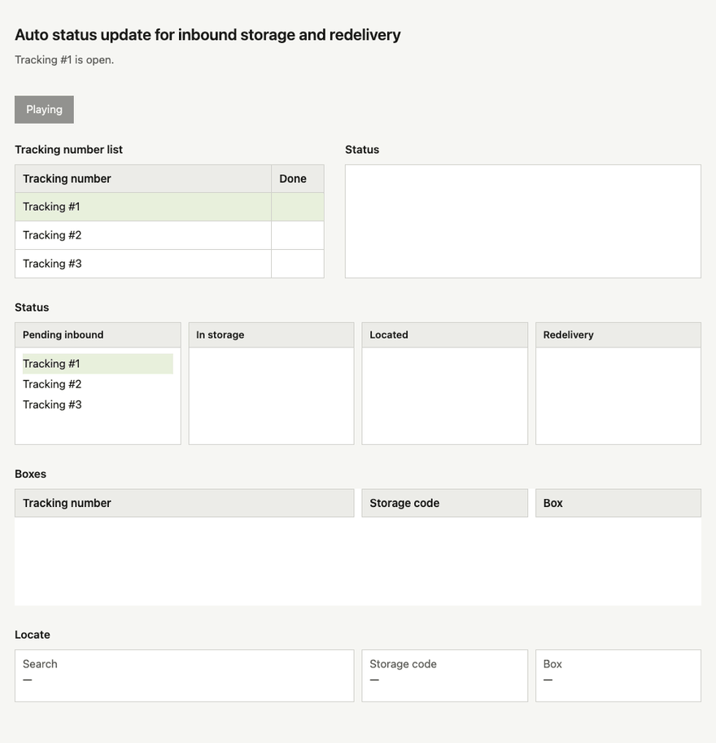

# UniMap Auto Inbound

**Auto-inbound to storage: simulates human clicks without API access, runs on a PC.**

This tool advances UniUni parcels into storage (status **215**) so people do not have to click each Next Transition by hand. There is no official API for that workflow, so it runs on a local PC, opens [UniUni Dispatch](https://dispatch.uniuni.com/main), and simulates the same clicks a human would make in **Edit Order → Operation**.

It reads order numbers from a Google Sheet (or the SI page) and, in Dispatch, follows Next Transition from the current status until **215**.

## Demo (anonymized sample, process logic only)



## Status path

Every step uses the same order: **Next Transition → Operation Location=`NJ Warehouse` → Submit**.

| Current status | Next Transition | Extra fields | Target |
|---|---|---|---|
| 190 / **255** | gateway processing | Operation Location | 199 |
| 199 / **195** / **1910** | parcel scan / parcel scanned | Operation Location | 200 |
| 200 | wrong address cfm in dispatch | Operation Location | 212 |
| 212 / **202** | deliver parcel apt | Operation Location; after Submit, dialog fail reason=`parcel damaged` | 211 |
| 211 | send parcel to storage | Operation Location + Network Node=`WH- JFK-005` | 213 |
| 213 | parcel abandon | Operation Location | 215 |

If the current status is any node in the table, continue from that node along the same path to 215.

**Safety:** if the tool hits a status code that was not specified, the status after a step does not match the target in the table, or it cannot find the Next Transition or an extra-field option, it stops immediately and does not process later orders.

## Install

Skip this if dependencies are already installed on this machine.

```bash
cd ~/Projects/unimap-auto-inbound
python3 -m venv .venv
source .venv/bin/activate
pip install -r requirements.txt
playwright install chromium
```

## Read a Google Sheet

Pick one of the three options. The default Sheet is `1yrR83W15kKevye87ksYnELUY68i_j4_kIIY_gu0bAWU`. The tool reads **column A** and skips the header.

1. **Service account (recommended)**
   - Put the JSON file at `credentials/unimap-put-in-storage-google-service-account.json`
   - Share the Sheet with that account's `client_email` as a Viewer

2. **Local CSV (fastest start)**
   - Export a CSV from the Sheet, then:
   ```bash
   LOCAL_CSV_FILE=./orders.csv ./run.sh
   ```

3. **Public link:** set the Sheet to "Anyone with the link can view"

## Recommended: Sheet menu plus a local listener

Apps Script handles the menu confirmation. This machine operates UniUni, because a Google script cannot click the web page for you.

1. Install the Sheet menu. See [`apps-script/README.md`](apps-script/README.md) and paste `Code.gs`
2. Configure the service account JSON, and share the Sheet with `client_email` as an Editor
3. Keep this running on the machine:

```bash
cd ~/Projects/unimap-auto-inbound
./run.sh --watch
```

4. In the Sheet, select the column A cell of the order number to start from
5. Use the menu **Auto inbound → Start from the selected order**
   - Every column A order from that row through the next blank row is written to the visible **Inbound queue** sheet
   - This machine searches and inbounds in queue order. At **215** it checks the order off and continues to the next one. The browser stays open
   - To stop, use **Stop continuous run**. The current order finishes, and the remaining pending rows are marked cancelled
   - After the batch, leave the terminal and the browser open. Select another order and use the menu again

## Trigger from the SI site

This machine still clicks UniMap. When you do not have source access to [us.si.uniuni.com](https://us.si.uniuni.com/), a browser script sends order numbers to this machine:

1. On this machine, double-click the `.command` launcher, log in to UniMap, and wait until the terminal shows `Local trigger listening on http://127.0.0.1:18787`
2. In Chrome, install [Tampermonkey](https://www.tampermonkey.net/)
3. Create a script, paste the full text of [`userscript/si-auto-inbound.user.js`](userscript/si-auto-inbound.user.js), and save
4. Open the SI site. A panel appears at the bottom right. Capture or paste order numbers, then start inbound

The Sheet menu still works. Both entries share the same local browser.

## Other commands

```bash
./run.sh --login-only          # log in only
./run.sh --next                # skip the menu; confirm in the terminal, then process the next order
./run.sh --order YOUR_ORDER_NO
./run.sh --limit 3
./run.sh --dry-run
```

The login session is stored in `.browser-profile/`.

## Related project

EWR delivery confirmation and DSP Tools now live in a separate directory: `~/Projects/delivery-pivot`
